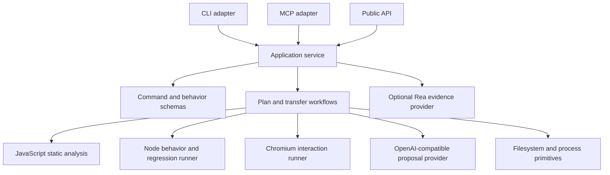

# Architecture

CLI, MCP and library consumers share application workflows and input schemas. Providers perform analysis or execution; they do not know about CLI flags or MCP transports.

| Directory | Responsibility |
| --- | --- |
| `src/adapters` | CLI presentation and MCP registration |
| `src/application` | Shared dispatch, policy, plans, snapshots, verification and export |
| `src/contracts` | Strict command, behavior and proposal schemas |
| `src/domain` | Structured diagnostics and shared version |
| `src/providers` | Static import analysis, Node and browser execution, model proposals and optional Rea client |
| `src/platform` | Filesystem boundaries, hashing, atomic writes, locks and bounded processes |
| `src/index.mjs`, `src/index.d.ts` | Public runtime exports and TypeScript declarations |

`contracts/commands.mjs` defines names, schemas, path fields and effects once. The adapters use that registry for parsing and registration; the application service validates again before dispatch. Generated documentation is checked against the registry. Architecture tests prevent providers and domain modules from importing adapters or application modules.

## Transfer invariants

Preparation freezes a contract and creates source, baseline and candidate snapshots. Adaptation changes the candidate with expected-file-hash checks. Verification compares source and candidate behavior against the declared cases, demonstrates a baseline gap, and checks unchanged destination regressions. Export rejects stale or incomplete evidence and constructs a patch from verified file inventories. Originals remain unchanged.

Execution through the shared service requires both caller policy and per-call authorization. MCP hides execution tools unless enabled at startup. Run locks serialize mutations, and hashes detect ordinary drift. These are local integrity controls, not a sandbox or protection against malicious code with write access to the evidence directory.

## Extending providers

Implement a provider under `src/providers` using explicit inputs and structured results. Keep execution bounded and authorized; retain failure, coverage and provenance information. A new runner needs evidence that checks actually completed—exit zero is insufficient. Wire it through an application workflow, expose its schema in the registry, then exercise it through the real adapter. There is no dynamic plugin loader yet.

Rea inspired the shared workflow, schema discovery and evidence organization. Portsmith implements a narrower destination-transfer workflow. Binary analysis, automatic dependency provisioning and general cross-framework conversion remain outside the current implementation. Autonomous adaptation consumes a frozen contract, requests schema-validated proposals, and runs the same verification gates after each attempt. Browser checks add evidence; they never replace the Node source/baseline/candidate gates.
