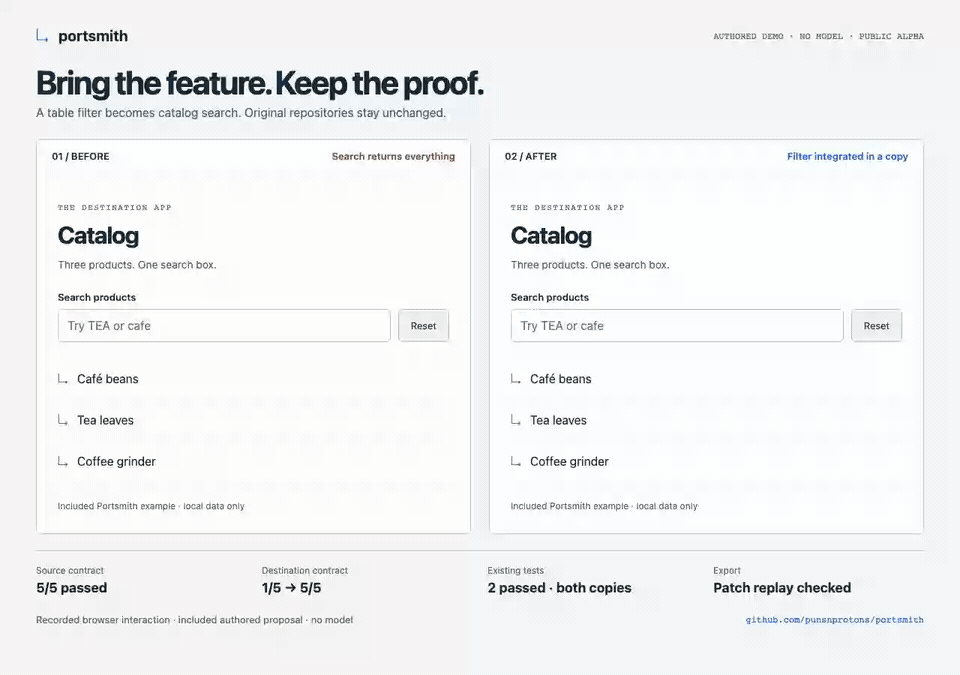

# Watch and reproduce the demo



[Still image without animation](assets/transfer-demo.png) · [Sanitized recording receipt](assets/demo-receipt.json)

## What you are seeing

Two real Chromium frames serve the unchanged destination and the verified candidate from a fresh local run. Typing `TEA` leaves three products in the unchanged catalog but finds only Tea leaves after integration. Typing `cafe` finds Café beans. Reset restores all three products. The recording script checks these results and fails on browser page errors.

The filter and proposal are **included, authored fixtures**. No model was used. Function results, regression counts and export status in the presentation come from the completed run; the comparison layout and captions are presentation only. It is a demonstration of this declared contract, not a claim about arbitrary repositories or autonomous model success.

The published `0.6.0-alpha.2` demo has the same example behavior with simpler browser styling. This recording uses the source checkout's refreshed UI.

## Run it from npm

```sh
npx --yes --package=portsmith-workbench@alpha portsmith-demo
npx --yes --package=portsmith-workbench@alpha portsmith-demo --install-browser
```

The first command runs function and regression checks. The second installs matching Chromium and adds browser checks. Both use fresh run directories and print their evidence paths. On minimal Linux hosts, install the Chromium OS dependencies first as described in [setup](setup.md).

## Reproduce the recording from source

Install supported Node, Git and `ffmpeg`, then:

```sh
npm ci --ignore-scripts
npm run browser:install
npm run demo:record
```

Run from the repository root. This executes only the included example code, verifies the transfer, exports and checks its patch, records actual browser interactions, then regenerates `docs/assets/transfer-demo.gif`, `transfer-demo.png` and `demo-receipt.json`. It requires local Chromium launch and loopback access. The MP4, original recording and full verification artifacts remain under a fresh ignored `.portsmith/recording-*` directory.

The receipt is a small, sanitized summary with media hashes; it is not a signed attestation or a substitute for rerunning the checks. Full evidence includes local paths and should be reviewed before sharing.

For your own feature, follow the [first-transfer walkthrough](first-transfer.md). For autonomous generation, use the separate [model workflow](autonomous.md).
